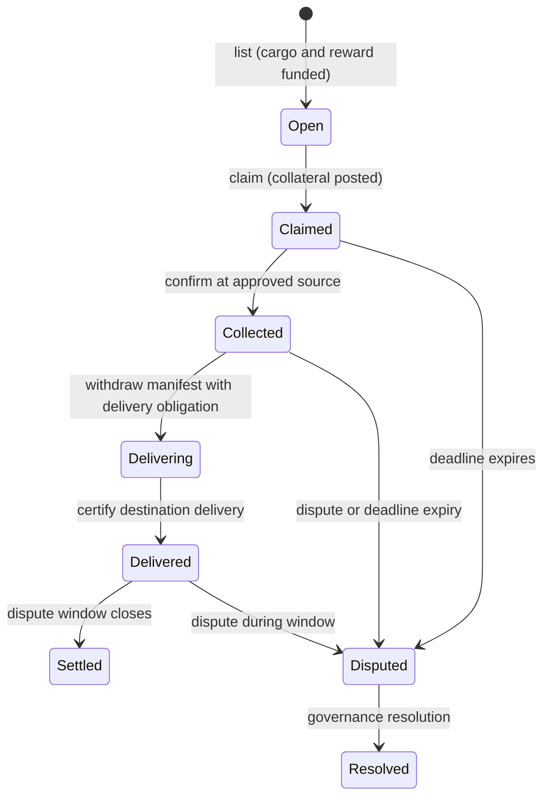

# ADR 0005: Endpoint-only transport

- **Status:** Accepted
- **Recorded:** 2026-10-06
- **Supersedes:** ADR 0002's gate registry, route, hop, and permit decisions;
  ADR 0003 decision 4; ADR 0004's route-bound listing terms

## Context

EVE Frontier travel does not have one complete, public on-chain representation.
Pilots may use ordinary stargates, smart gates, or other movement. The starmap is
off-chain, and on-chain locations may be deliberately obfuscated. A contract that
requires a sequence of smart-gate permits would therefore validate only one subset
of legitimate travel while presenting that subset as the haul's route.

Minehaul's enforceable value is at the commercial boundaries: an approved manifest
is collected from a source, delivered to a destination before a deadline, and then
settled under agreed reward, collateral, and dispute rules.

## Decision

1. A Transfer commits to a source SSU and destination SSU. It does not store a route,
   waypoint list, location path, or gate list.
2. The approved hauler confirms collection and changes the job from `Claimed` to
   `Collected`. The source was already verified during network registration and
   checked when the job was listed and claimed.
3. Delivery creates a non-droppable request bound to the approved destination,
   manifest, hauler, job, network, and adapter registry. The existing delivery proof
   and delayed settlement rules remain unchanged.
4. The core protocol does not register gates, mint gate witnesses or permits, record
   hops, or enforce how the hauler travels.
5. `ActionListed` exposes the source and destination IDs for indexers. Route hashes
   and route lengths are removed.
6. Private instructions, price estimates, pathfinding, risk policy, and navigation
   remain off-chain. A future extension may commit to opaque instructions, but core
   settlement will not interpret them.

The lifecycle is:

## Consequences

- Every valid travel mechanism can satisfy the same haul contract.
- Minehaul avoids revealing, guessing, or falsely validating a pilot's path.
- Network configuration and job objects are smaller. Gate registry state, route
  cursors, route hashes, permit TTLs, and related events disappear.
- Route-specific pricing and compliance are advisory off-chain concerns unless a
  separate extension introduces them.
- The security boundary is clearer: registered adapters attest the source SSU facts
  and full destination delivery; Minehaul enforces the economic agreement around
  those facts.
- This changes public function signatures and stored object layouts. Existing
  deployments require an explicit migration or a new package publication.

## Verification

- Transfer integration tests cover endpoint validation, wrong-sender collection,
  and destination delivery without any route input.
- Compiler probes continue to reject forged handler permits and discarded delivery
  obligations or proofs.
- The local game fixture verifies live source/destination SSUs and seeded cargo,
  publishes Minehaul with chain-aligned package IDs, and settles a complete haul
  through its explicit local delivery simulator. Optional gates are environmental
  data and are not inputs to Minehaul.
