# ADR 0006: Agreement as the protocol primitive

- **Status:** Proposed
- **Recorded:** 2026-10-22
- **Builds on:** [ADR 0004](0004-transfer-settlement-and-proofs.md) (delayed settlement,
  permit-bound adapters, fixed listing terms) and
  [ADR 0005](0005-endpoint-only-transport.md) (the protocol does not enforce how
  goods travel)
- **Would amend, once accepted:** ADR 0004's governance-only `Resolved` outcome and
  its fixed loss payout policy
- **Addresses:** #13 (dispute liveness), and the resolver half of #16 (who holds a
  global kill switch)
- **See also:** [ADR 0007](0007-network-authority.md) (party authority, which
  decision 8 defers to) and [ADR 0008](0008-distribution-intents.md) (exploratory;
  one possible answer to open question 5)

## Context

### What a haul job is today

A `HaulAction` is a shared object holding a Transfer job's terms, the cargo, the
reward and the hauler's collateral. Its lifecycle is in
`packages/minehaul_core/sources/action.move`:

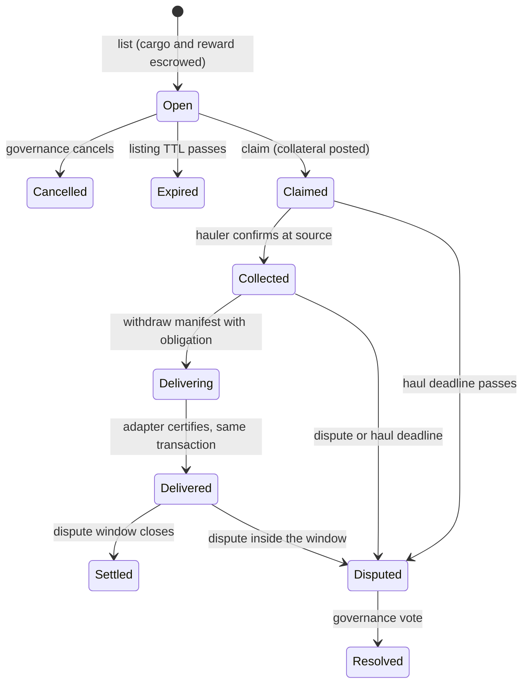

Most of this lifecycle has nothing to do with hauling. It is the shape of any
arrangement where one party funds an outcome, another commits to deliver it, and
someone has to decide when they disagree. Only `Collected` and `Delivering` are
specific to moving goods.

### Armature is wired into the parts that are not about hauling

Armature does two different jobs today, and the code does not separate them:

1. **Party authority.** The network is armature DAO type-state. Only an approved
   proposal can list or cancel a job, and claiming checks DAO membership
   (`network::assert_can_haul`).
2. **Arbiter.** Only an armature proposal can end a dispute
   (`action::resolve_dispute<P, K>`, which takes `ExecutionRequest<P>`).
   `dispute_action` also lets any DAO governance member open one.

The arbiter role is hard-coded in three ways:

- **One kind of judge.** Nothing but an armature proposal can resolve a dispute.
- **One shape of outcome.** `resolve_dispute` takes `award_to_hauler: bool` and
  `slash_bps: u16`. Every other split of the escrow is impossible.
- **One payout policy.** On a loss the lister gets the slashed share of collateral,
  and the treasury gets the rest of the collateral plus the whole reward.

### What the chain can and cannot enforce

The chain controls the escrowed balances completely: nothing leaves escrow except
through the job's rules. It does not control the hauler's conduct in the game.
Once goods are in a hauler's inventory, no transaction can make them arrive. ADR
0005 already accepts this: the protocol commits to endpoints and never to the
path.

So a haul job does not guarantee an outcome. It **enforces the stakes and judges
the performance**. That is the difference between an agreement and a contract.

### Three problems with the current arbiter

- **The judge is a party.** The DAO that owns the network and approved the
  listing also rules on disputes between its lister and a hauler. Within one
  network that may be acceptable. Between two organisations, neither will accept
  the other's DAO as judge.
- **Disputes can last forever.** `Disputed` ends only through a governance vote.
  Until then the reward, the collateral and any undelivered cargo are locked (#13).
- **Disputes can be used to grief.** Any governance member, or the lister, can
  dispute a collected haul and freeze it.

### Wider ambitions

- **Agreements between organisational units (OUs) in armature.** These have the
  same shape: commitments, stakes, and a judge both sides accept. Building this
  with armature as the only judge would bring back the conflict of interest above.
- **Trinary Exchange.** Its trades are *not* agreements. They settle atomically
  when an order matches, and its docs state there is "no deferred settlement". The
  agreement starts afterwards, when traded goods have to be physically moved: a
  trade *followed by* a haul agreement.

## Definitions

| Term | Meaning |
|---|---|
| **Contract** | An arrangement whose outcome is enforced when it is created or executed. A Trinary Exchange fill is a contract: both sides settle in the same transaction. |
| **Agreement** | An arrangement with at least one **obligation that outlives the transaction that creates it**. The parties' holdings are escrowed and enforced on-chain. Performance is **attested**, not enforced. Breaches go to a **resolver** the parties accepted when the agreement formed. |
| **Party** | An address with obligations or rights under the agreement. A haul has two: lister and hauler. |
| **Terms** | Domain data the agreement carries but does not interpret, for example the endpoints and cargo manifest of a haul. |
| **Holding** | A balance escrowed by the agreement, owned by one party and of one kind (below). |
| **Consideration** | A holding paid for performance. The haul reward. |
| **Bond** | A holding at risk if its owner breaches. The hauler's collateral. |
| **Custody** | A party's goods held so the agreement can hand them over. The haul cargo. Custody is never redistributed by a ruling; whatever was not handed over returns to its owner. |
| **Attestor** | Code trusted to certify that an obligation was performed. For hauls, a registered delivery adapter. |
| **Resolver** | Code trusted to rule on a dispute. An armature proposal is one resolver; it is not the only possible one. |
| **Ruling** | An outcome plus a distribution of every consideration and bond holding among the eligible recipients. |
| **Default ruling** | The ruling applied when the resolver does not rule in time. Fixed when the agreement forms. |
| **Discharge** | Normal completion: performance attested and not challenged in time. |

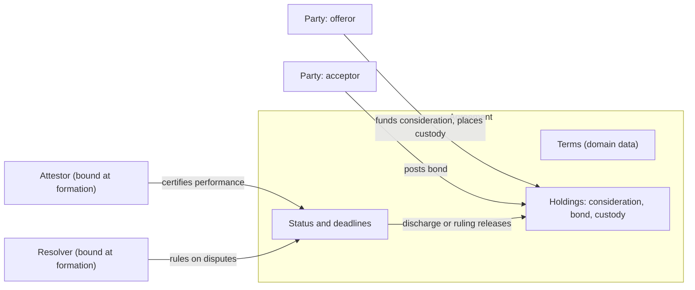

## Decision

### 1. Agreement is the category; a haul job is one instance

Minehaul adopts the definition above. A haul job is an agreement whose terms are
endpoints and a manifest, whose attestor is the network's delivery adapter
registry, and whose resolver the network chooses.

The test for whether something new belongs on this model: **does an obligation
outlive the transaction that creates it?** If it does, it is an agreement.
Otherwise it is a contract and does not need this machinery.

### 2. One generic lifecycle; domains add milestones inside it

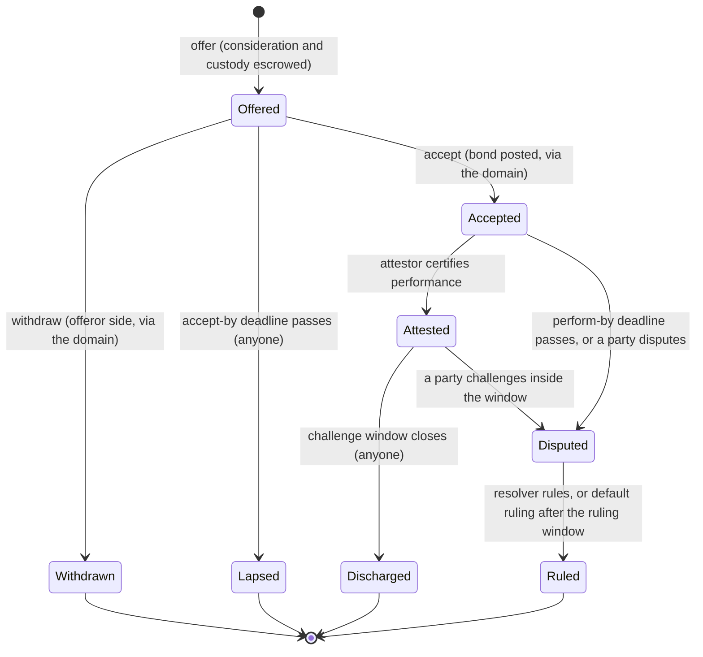

- **Domain milestones are sub-states of `Accepted`.** The generic status stays
  `Accepted`; the domain keeps its own progress in its terms. For a haul those
  milestones are `Collected` and the transient `Delivering`.
- **Terminal states pay out once.** `Withdrawn`, `Lapsed`, `Discharged` and
  `Ruled` are final, as `Settled` and `Resolved` are today.
- **Time moves agreements without permission; everything else needs authority.**
  Lapsing, discharge and the default ruling can be triggered by anyone once their
  deadline passes. Offering, accepting, withdrawing and disputing go through the
  domain. Attesting and ruling go through the bound attestor and resolver.

### 3. Holdings have an owner and a kind, and rulings respect both

Each escrowed balance is keyed by owner, kind and asset. The current design
already stores balances as dynamic object fields; only the key gains the owner and
kind:

```move
public enum HoldingKind has store, copy, drop { Consideration, Bond, Custody }

public struct HoldingKey has store, copy, drop {
    owner: address,
    kind: HoldingKind,
    collection_id: ID,
    asset_id: u64,
}
```

The rules:

- **Discharge:** consideration goes to the performing party, minus any fee
  share the terms fix (the haul treasury split). Bonds return to their owners.
  Custody has already been handed over by the attested performance.
- **Ruling:** must allocate every consideration and bond holding still escrowed,
  each exactly once, with shares summing to 10,000 bps.
- **Eligible recipients:** fixed at formation. A ruling can pay only the parties
  and beneficiaries named then (for hauls, the treasury). A resolver cannot pay
  itself or an outsider.
- **Custody:** a ruling never allocates it. Custody still held returns to its
  owner, as `refund_cargo` does today.

### 4. Two plug points: the attestor and the resolver

Move has no interfaces or dynamic dispatch. Minehaul already solves the same
problem for adapters with compiler-issued permits (ADR 0004 decision 3). The
resolver and attestor use the same mechanism:

```move
/// Which code may act, and on whose behalf. Fixed when the agreement forms.
public struct Binding has store, copy, drop {
    kind: TypeName, // type_name::with_defining_ids<R>() of the plug's marker
    instance: ID,   // which judge or attestor of that kind, e.g. a DAO's ID
}
```

- **`kind`** says which module may act: only the module defining the marker type
  `R` can create `Permit<R>`.
- **`instance`** says which judge of that kind. Many DAOs share one armature
  resolver module, so the agreement must also record *which* DAO rules.
- **The split of responsibility is explicit.** Core checks that the permit's type
  and the claimed instance match the binding. The plug's module checks that its
  caller really speaks for that instance. For example, the armature resolver
  checks `ExecutionRequest.req_dao_id() == instance`.

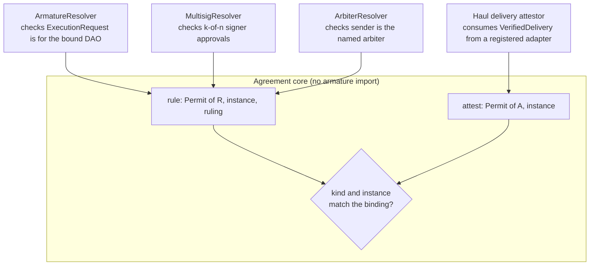

Bindings are fixed at formation, like the treasury and dispute window today
(ADR 0004 decision 5). The parties know who attests and who judges before they
commit funds, and nobody can swap them afterwards.

### 5. The resolver entry point and the ruling shape

A sketch of the core surface, not final API:

```move
public enum Outcome has store, copy, drop { Performed, Breached, Void }

public struct Share has store, copy, drop { recipient: address, bps: u16 }

public struct Allocation has store, copy, drop {
    holding: HoldingKey,
    shares: vector<Share>,
}

public struct Ruling has store, copy, drop {
    outcome: Outcome,
    allocations: vector<Allocation>,
}

/// Only the module defining R can call this. Aborts unless the agreement is
/// Disputed, R and instance match the resolver binding, the ruling window is
/// open, and the ruling is valid (rule 3 above).
public fun rule<T: store, R>(
    _permit: Permit<R>, agreement: &mut Agreement<T>, instance: ID,
    ruling: Ruling, clock: &Clock, ctx: &mut TxContext,
);
```

Today's two outcomes are two rulings among many:

| Today | As a ruling |
|---|---|
| `award_to_hauler = true` | `Performed`: reward 100% to hauler less the treasury split; collateral 100% to hauler |
| `award_to_hauler = false, slash_bps = 2500` | `Breached`: collateral 25% to lister, 75% to treasury; reward 100% to treasury |
| Not expressible today | `Breached`: collateral 50% to lister, 50% to hauler; reward 100% back to lister |
| Not expressible today | `Void`: every holding back to its owner |

Through armature, the flow looks like this:

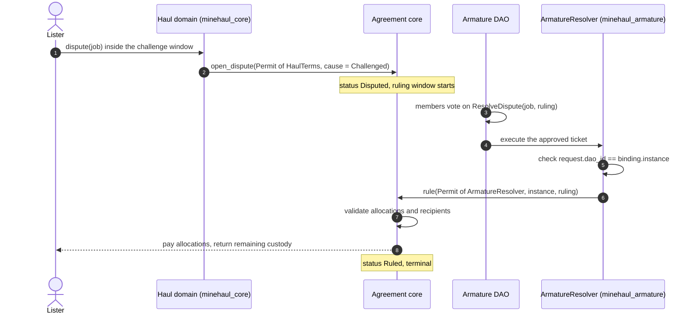

### 6. Every dispute has an exit: the default ruling

Each agreement carries a **ruling window** and a **default ruling for each
dispute cause**, both fixed at formation:

```move
public enum DisputeCause has store, copy, drop {
    DeadlineMissed, // perform-by passed with no attestation
    Challenged,     // a party disputed
}
```

If the resolver has not ruled when the window closes, anyone can apply the
default for the cause that opened the dispute:

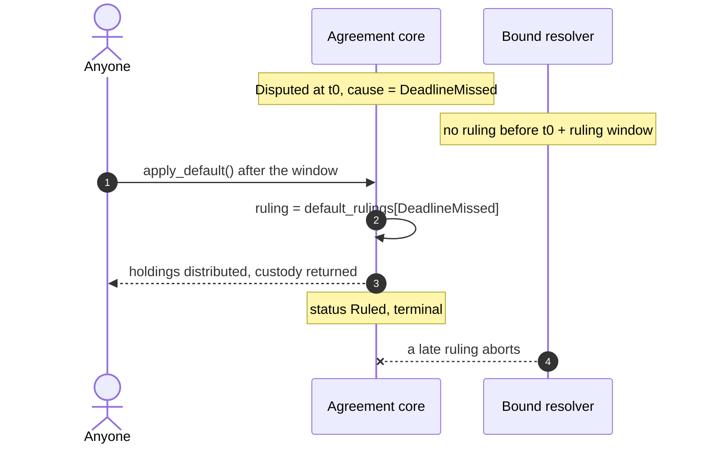

This closes #13. A resolver that never acts can delay an outcome but cannot block
one. The default values per cause are a network policy decision (open questions).

### 7. Domains own their transitions through `Permit<Terms>`

The agreement is generic over its terms type, and the module that defines the
terms is the only one that can drive domain transitions:

```move
public struct Agreement<T: store> has key {
    id: UID,
    terms: T,                    // opaque to the agreement core
    parties: vector<address>,
    recipients: vector<address>, // everyone a ruling may pay
    attestor: Binding,
    resolver: Binding,
    status: Status,
    accept_by_ms: u64,
    perform_by_ms: u64,          // set at acceptance
    challenge_window_ms: u64,
    ruling_window_ms: u64,
    default_rulings: vector<CauseRuling>,
}

/// Domain-gated: only the module that defines T can create Permit<T>.
public fun accept<T: store>(_permit: Permit<T>, a: &mut Agreement<T>, acceptor: address, bond: Balance, clock: &Clock);
public fun withdraw<T: store>(_permit: Permit<T>, a: &mut Agreement<T>, ctx: &mut TxContext);
public fun open_dispute<T: store>(_permit: Permit<T>, a: &mut Agreement<T>, by: address, cause: DisputeCause, clock: &Clock);
public fun terms_mut<T: store>(_permit: Permit<T>, a: &mut Agreement<T>): &mut T;

/// Permissionless once their deadline passes.
public fun lapse<T: store>(a: &mut Agreement<T>, clock: &Clock, ctx: &mut TxContext);
public fun discharge<T: store>(a: &mut Agreement<T>, clock: &Clock, ctx: &mut TxContext);
public fun apply_default<T: store>(a: &mut Agreement<T>, clock: &Clock, ctx: &mut TxContext);
```

The haul domain keeps its policy and enforces it before calling the generic
transition:

- **Who may list and cancel.** The network's listing authority
  ([ADR 0007](0007-network-authority.md)): an approved armature proposal on an
  armature-governed network, the owner on an owner-governed one.
- **Who may claim.** The network's claim policy (ADR 0007): members, auxiliary
  haulers or the open marketplace, in any combination.
- **The collateral minimum.** Rounded up, as today.
- **Who may dispute.** The parties, plus whoever the network's dispute policy
  (ADR 0007) adds. Governance members are no longer added by a hard-coded rule.
- **The delivery handoff.** The non-droppable `DeliveryRequest` and
  `VerifiedDelivery` from ADR 0004 are unchanged. The haul attestor module consumes
  `VerifiedDelivery` and then calls `attest` with its own permit.

### 8. Party authority stays out of the agreement core

Who governs a network (listing approval, membership, adapter trust) is a domain
concern, not a property of agreements. The **agreement core never imports
armature**, and armature resolution becomes one resolver module among several.

How the haul domain decides party authority is
[ADR 0007](0007-network-authority.md): networks become Minehaul objects, armature
becomes one network authority among others, and `minehaul_core` stops importing
armature too.

Today:

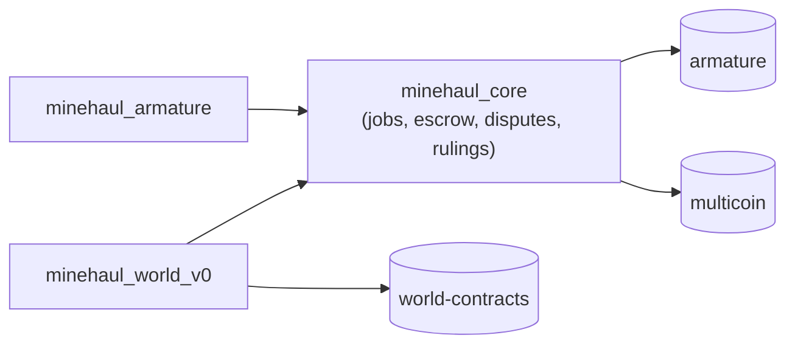

Proposed, after phase 2 and ADR 0007:

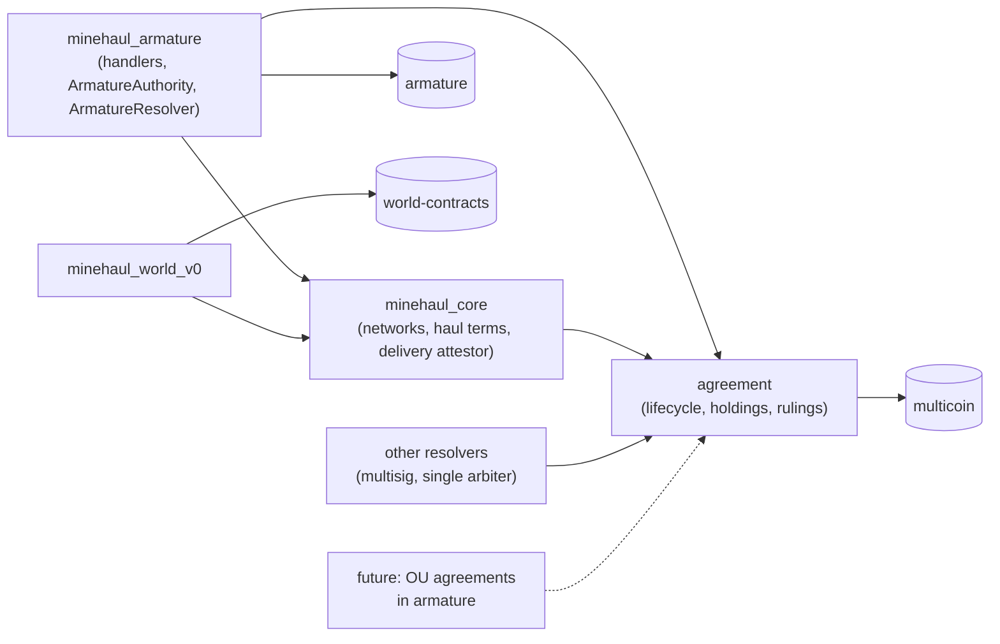

The edges that must never exist are `agreement → armature` and, once ADR 0007 is
accepted, `minehaul_core → armature`.

### 9. How a haul maps onto an agreement

| Haul (today) | Agreement | Notes |
|---|---|---|
| Lister | Offeror party | Fixed by the listing the network's authority approved: the armature payload, or the owner's call (ADR 0007) |
| Hauler | Acceptor party | Bound at claim |
| Treasury | Eligible recipient | Not a party; it can only receive what terms or rulings give it |
| Reward | Consideration (lister's) | |
| Collateral | Bond (hauler's) | Must be in the reward asset, as today |
| Cargo | Custody (lister's) | Released only by the attested handoff |
| `Open` | `Offered` | |
| `Cancelled` / `Expired` | `Withdrawn` / `Lapsed` | Both refund consideration and custody |
| `Claimed`, `Collected`, `Delivering` | `Accepted` plus haul milestones | `Delivering` is never stored |
| `Delivered` | `Attested` | Opens the challenge window (today's dispute window) |
| `Settled` | `Discharged` | |
| `Disputed` / `Resolved` | `Disputed` / `Ruled` | `Ruled` can be reached by the default ruling |

Each box below is an agreement status; the states inside it are the haul
statuses that map to it:

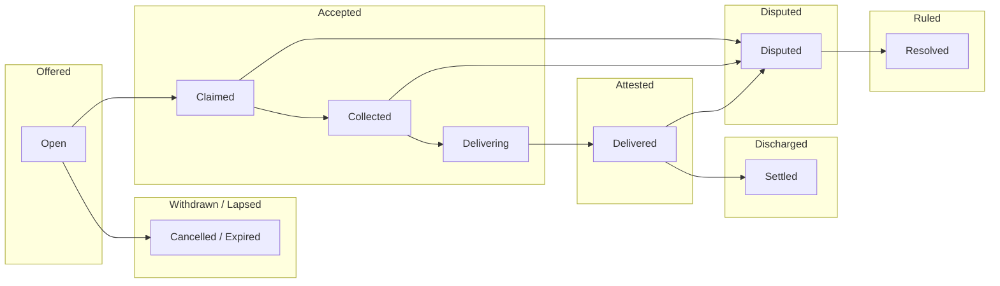

### 10. Events describe the agreement; domains add detail

The agreement core emits one event per generic transition: `AgreementOffered`,
`AgreementAccepted`, `AgreementAttested`, `AgreementDisputed`, `AgreementRuled`
(with the outcome and whether it was the default), `AgreementDischarged`,
`AgreementWithdrawn` and `AgreementLapsed`. Domain events such as `ActionListed`
(endpoints and manifest) and collection keep their detail and carry the agreement
ID. As today, indexers must treat attestation and discharge as two phases of one
job.

### 11. Delivered in two phases

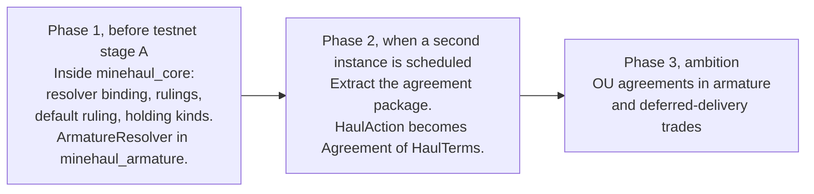

**Phase 1 builds the seam now, inside the existing packages.** Object layouts are
still free to change because nothing is deployed, and #13 needs this work anyway.
Concretely:

- **Network config:** gains a resolver binding, a ruling window and default
  rulings per cause. Listing snapshots them, as it snapshots the dispute window.
- **`resolve_dispute`:** its `award_to_hauler` and `slash_bps` arguments are
  replaced by `rule` with a `Ruling`. The armature handler becomes
  `ArmatureResolver`.
- **`dispute_action`:** its built-in governance-member check moves into the
  network's dispute policy (ADR 0007 decision 4).
- **Other resolver kinds:** a single named arbiter and a k-of-n multisig, so the
  seam is tested by more than one implementation.

**Phase 2 extracts the generic package once a second instance is scheduled.**
Candidates are an OU agreement, Inject/Extract jobs, or a deferred-delivery trade.
With one instance we would be guessing which parts are generic; `Collected`
already shows that milestones vary by domain.

**Phase 3 applies the primitive outside hauling.** That is the ambition, not a
commitment of this ADR.

### 12. Composition with Trinary Exchange

A trade and its delivery stay separate: the trade is a contract, the delivery an
agreement. They can compose in one programmable transaction because both hold
the same multicoin `Balance` type. That requires both packages to resolve
multicoin to the same published package (see Consequences).

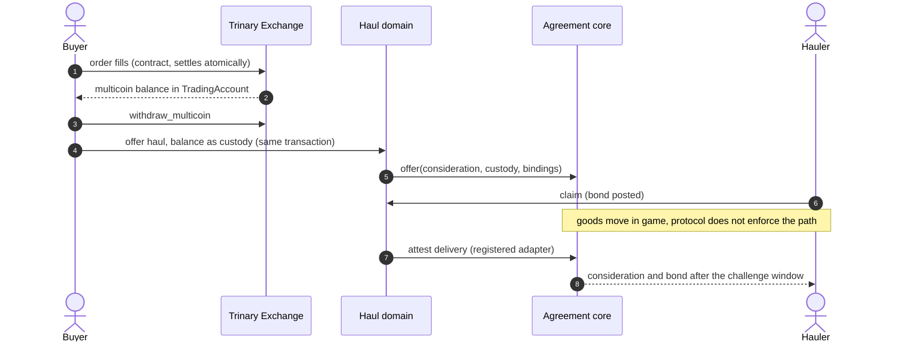

This is illustrative. Who may offer a haul on a network is still the network's
listing policy.

## Consequences

**Positive**

- **A neutral judge is possible.** A network can bind a resolver its counterparties
  trust, which agreements between organisations require.
- **Disputes always end.** The default ruling replaces "locked until governance
  votes", closing #13 by construction.
- **Rulings are expressive but bounded.** Any split of consideration and bonds
  among named recipients is possible. Paying outsiders and redistributing custody
  are not.
- **Armature stays optional.** The agreement core can be reused by systems that do
  not use armature.
- **One security pattern throughout.** Adapters, attestors, resolvers and domains
  are all bound by type and gated by `Permit<T>`, already proven with compiler
  probes.

**Negative**

- **Testnet slips.** Phase 1 changes the listing payload, network config, the
  dispute API and stored layouts before testnet stage A.
- **Resolvers are trusted code.** A malicious or buggy resolver module can rule
  anything within the constraints. Choosing a resolver is a trust decision, as
  registering an adapter is today.
- **Instance authentication sits in the plug's module.** Core cannot check that a
  resolver really speaks for its bound instance. Every resolver needs its own
  tests for this.
- **Indexers must be rewritten.** Events and status names change, and one job is
  represented by both agreement and haul events.

**Neutral**

- **Delivery is unchanged.** The obligation and proof model of ADR 0004 is kept.
  It becomes the haul attestor's implementation.
- **Shared types must match.** A trade balance can flow into a haul only if Trinary
  Exchange and Minehaul resolve multicoin to the same published package. As of
  this ADR they pin different revisions (`2772c26` and `c7a97f2`); confirm this
  before composing them on testnet.

## Alternatives considered

- **Keep armature as the built-in judge.** Rejected: it keeps the conflict of
  interest, cannot serve agreements between organisations, and leaves #13 open.
- **Bind a resolver capability object instead of a type.** Not rejected, but
  subsumed: a capability resolver is one resolver kind whose module checks the
  presented capability. Type-and-instance binding expresses that and also lets a
  resolver authenticate through governance or signatures.
- **Choose the resolver when a dispute opens.** Rejected: parties must know the
  judge before they commit funds, and whoever picks the judge at dispute time
  gains an advantage.
- **Build the agreement inside armature.** Rejected: armature would become a
  hard dependency, which this ADR exists to avoid.
- **Extract the generic package immediately.** Deferred to phase 2 because we
  have only one instance.
- **Dynamic dispatch through stored function references.** Not available in Sui
  Move; compiler-issued permits are the idiomatic substitute, as in ADR 0004.

## Open questions

1. **Disputing rights and griefing.** Who may open a dispute in each state, and
   should opening one require a bond that the loser forfeits?
2. **Haul default rulings.** What should the default be for each cause? For
   example, `Performed` for an unanswered challenge after attested delivery, and
   `Breached` with the network's slash share for a missed deadline.
3. **Where does a loser's reward go?** Today it goes to the treasury on a loss.
   Should rulings be able to return it to the lister by default?
4. **Appeals and consent.** Can the parties jointly replace the resolver, or
   appeal a ruling to a second resolver?
5. **Partial performance and more than two parties.** The haul manifest is
   all-or-nothing. Do other instances need partial attestation or several
   acceptors? [ADR 0008](0008-distribution-intents.md) explores keeping agreements
   two-party and carving partial fills out of one offer.
6. **Is a challenge window always required?** Every haul has one. Some agreements
   may want discharge on attestation.
7. **OU agreements and armature.** These need armature to drive the agreement
   from proposals with read-only DAO access. That depends on the upstream API ADR
   0003 is waiting for.
8. **Naming.** Agreement, `Ruled` and `Discharged` are working names.

## Verification (planned)

- **Binding checks:** a resolver or attestor with the wrong marker type or the
  wrong instance is rejected; so is a ruling outside the ruling window.
- **Ruling validity:** a ruling that pays a non-recipient, reallocates custody,
  omits or duplicates a holding, or does not sum to 10,000 bps aborts.
- **Default ruling:** applies only after the window, uses the dispute's cause, and
  prevents a later ruling.
- **Single payout:** every terminal state is final and pays once, as today.
- **Compiler probes:** `scripts/check-security-boundaries.sh` gains a forged
  resolver permit and a forged domain permit, both of which must fail to compile.
- **Live scenarios:** the acceptance matrix gains an unanswered dispute settled
  by the default ruling and a dispute resolved by a non-armature resolver, and
  re-expresses today's two resolution scenarios as rulings.
