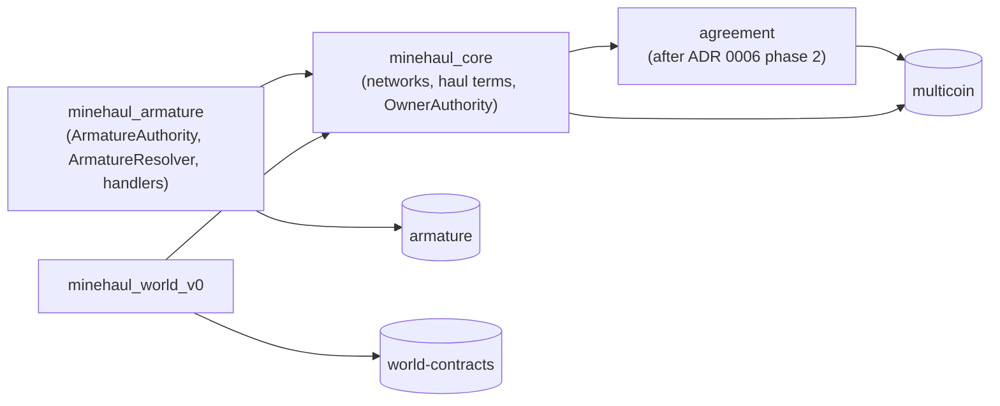

# ADR 0007: Networks are Minehaul objects with a pluggable authority

- **Status:** Proposed
- **Recorded:** 2026-10-28
- **Builds on:** [ADR 0006](0006-agreement-primitive.md) (bindings of a marker
  type and an instance, gated by `Permit<T>`)
- **Would supersede, once accepted:** [ADR 0002](0002-logistic-network-architecture.md)
  decisions 1, 2 and 5; [ADR 0003](0003-haul-actions-read-only-network.md)
  decision 2
- **Would amend, once accepted:** ADR 0006 decision 8 (armature as the fixed
  party authority) and its proposed dependency graph

## Context

### Minehaul's position

Minehaul is a logistics protocol: it is about where goods are, not what they
cost ([vision](../vision.md)). A **network** is a set of depots (SSUs) with
shared policy, and many logistics statements are about such a set. Grouping
depots is therefore part of Minehaul's own model, not a convenience borrowed
from a governance framework.

### Networks are armature DAO state today

ADR 0002 decision 1 stores `LogisticNetwork` inside an armature DAO as type-state,
keyed by the proposal marker `ConfigureLogisticNetwork`. Every governed operation
in core takes an armature `ExecutionRequest<P>`, and two checks ask armature
about membership:

| Where | What armature provides |
|---|---|
| `network::init_network`, `set_config`, `set_paused`, `register_ssu`, `unregister_ssu`, `add_auxiliary_hauler`, `remove_auxiliary_hauler` | Storage (`dao::borrow_type_state_mut`) and authorisation (`ExecutionRequest<P>` for the same DAO) |
| `network::assert_can_haul` | `dao::is_governance_member` as one way to be allowed to claim |
| `witnesses::new_registry`, `register_adapter`, `revoke_adapter` | Authorisation of adapter trust (`ExecutionRequest<P>`) |
| `action::create_action`, `cancel_action` | Authorisation of listing and cancelling |
| `action::dispute_action` | `dao::is_governance_member` as one way to be allowed to dispute |
| `action::resolve_dispute` | The judge; ADR 0006 already moves this behind a resolver binding |
| `OwnershipMode::Vaulted` | Meaning: the SSU's `OwnerCap` sits in the DAO's capability vault |
| Lifecycle type parameter `K` (ADR 0003 decision 2) | Names the DAO type-state slot the network lives in |

ADR 0006 separates armature's two jobs, judge and party authority, but only
unplugs the judge. Its decision 8 keeps armature as the party authority, so
after ADR 0006 `minehaul_core` still imports armature.

### The proposal to group depots by organisational unit

It has been proposed to organise networks around armature organisational units
(OUs): an OU groups a set of SSUs, and the SSUs' transponder codes are gated by
the OU's role in armature's keyspace. The grouping and the access control are
both useful. Building them into core would make an armature DAO, and later an
OU, a precondition for using Minehaul at all: a solo operator, a corporation on
another governance system, or a test harness would all need armature to declare
a single depot set.

### Constraints that still hold

- **Hauls must not write network state** (ADR 0003 decision 1). Many jobs run at
  once; if lifecycle calls wrote the network, they would all queue on it.
- **Voter-visible intent stays binding.** An approved listing cannot be redirected
  (ADR 0002, ADR 0004 decision 5).
- **Adapter revocation stays per network** (the fix in `90eb2df`). One network's
  authority must never be able to disable an adapter for others.
- **No dynamic dispatch.** Move has no interfaces; plug points are bindings
  checked against compiler-issued permits, as in ADR 0004 and ADR 0006.

## Decision

### 1. The network is a shared object owned by Minehaul

`minehaul_core::network::Network` becomes its own shared object. Its ID is the
network ID. It holds what `LogisticNetwork` holds today (config, registered
depots, auxiliary haulers, the paused flag, the adapter registry ID) plus an
authority binding:

```move
public struct Network has key {
    id: UID,
    authority: Binding,        // ADR 0006 Binding { kind, instance }
    config: NetworkConfig,
    registered_ssus: VecMap<ID, RegisteredSsu>,
    auxiliary_haulers: VecSet<address>,
    paused: bool,
    registry_id: ID,
}
```

A DAO, an OU or a single owner can create any number of networks. "One network
per DAO" is no longer structural; an authority that wants it enforces it itself.

### 2. Every governed operation takes the authority's permit

Core checks the permit's type and the claimed instance against the binding; the
authority's module checks that its caller really speaks for that instance. This
is the same split of responsibility as ADR 0006 decision 4.

```move
/// Aborts unless A and instance match net.authority.
public fun set_config<A>(_permit: Permit<A>, net: &mut Network, instance: ID, config: NetworkConfig);
public fun set_paused<A>(_permit: Permit<A>, net: &mut Network, instance: ID, paused: bool);
public fun register_ssu<A>(_permit: Permit<A>, net: &mut Network, instance: ID, vssu: VerifiedSsu, mode: OwnershipMode);
public fun unregister_ssu<A>(_permit: Permit<A>, net: &mut Network, instance: ID, ssu_id: ID);
public fun set_authority<A>(_permit: Permit<A>, net: &mut Network, instance: ID, next: Binding);
```

The same applies to adapter trust (`register_adapter`, `revoke_adapter` take
`Permit<A>` and `&Network` instead of an `ExecutionRequest<P>`) and to listing
and cancelling (`create_action<A>`, `cancel_action<A>`).

`set_authority` hands a network to a new authority, for example from a founder's
owner capability to a DAO. Jobs already listed are unaffected: they snapshot their
resolver and terms when listed (ADR 0006 decision 4), so a handover changes only
future listings.

### 3. Who may claim is a policy in the config

Claiming is not a governance action, so it cannot rely on a governance permit
alone. The config states the policy:

```move
public enum ClaimPolicy has store, copy, drop {
    Open,       // anyone (today's allow_open_marketplace)
    Allowlist,  // only addresses in auxiliary_haulers
    Delegated,  // the claim must carry Permit<A> for the network's authority
}
```

Under `Delegated`, the hauler claims through the authority's module, which checks
its own membership rule and then calls core with its permit. This is where
armature membership lives: the armature authority accepts DAO governance members,
and later OU roles. Grouping depots by OU and gating access by keyspace role become
policies of the armature authority, not assumptions of core.

The same pattern covers who may dispute besides the parties (ADR 0006 phase 1
already moves that check out of `dispute_action`).

### 4. Haul lifecycle calls read `&Network`

Every lifecycle function takes `&Network` instead of `&DAO`, so ADR 0003 decision 1
(hauls never write network state) is kept. The type parameter `K` that named the
DAO type-state slot (ADR 0003 decision 2) is removed: the network is identified by
its object ID, which the job records at listing.

### 5. Depot custody is the authority's business

`OwnershipMode::Vaulted { cap_id }` keeps its shape. Its meaning becomes "the
SSU's `OwnerCap` is held under the network authority's control". The armature
authority keeps it in the DAO's capability vault, as today; an owner-capability
authority keeps it with the owner. Core never inspected the vault, so nothing in
core changes.

### 6. Authorities shipped with Minehaul

- **`ArmatureAuthority`** in `minehaul_armature`. The instance is the DAO's ID.
  The existing proposal handlers (`ConfigureLogisticNetwork`, `ListHaulAction`,
  cancellation) verify their `ExecutionRequest<P>`, check
  `req.req_dao_id() == instance`, and call core through one package-internal
  module that issues `Permit<ArmatureAuthority>`. Under `Delegated`, it allows
  claims from DAO governance members. OU-scoped networks use an OU's identity as
  the instance once armature's OU API exists.
- **`OwnerAuthority`** in `minehaul_core`. The instance is the ID of a
  `NetworkOwnerCap` object; holding the cap authorises governed operations. This
  lets a network run without any governance framework, and lets tests run
  without a DAO.

Two implementations from the start mean the seam is exercised by more than one
authority, as ADR 0006 requires for resolvers.

### 7. Core stops importing armature

With ADR 0006 moving the judge and this ADR moving party authority, no module in
`minehaul_core` imports armature.



The edges that must never exist are `minehaul_core → armature` and
`agreement → armature`.

### 8. Delivered together with ADR 0006 phase 1

Both change the network config, the listing payload and the dispute path, and
nothing is deployed yet. Doing them in one pass avoids migrating stored layouts
twice.

## Consequences

**Positive**

- **Minehaul stands on its own.** A network needs a Minehaul object and an
  authority, not an armature DAO.
- **Organisations can run several networks**, for example one per OU, region or
  depot temperature, without separate DAOs.
- **The OU proposal still works**, as a policy of the armature authority.
- **Simpler signatures.** `K` disappears from every lifecycle call, and
  governance writes touch the network object instead of the DAO.
- **Tests no longer need a DAO** for anything except the armature authority's
  own tests.

**Negative**

- **Governance is no longer free.** Under ADR 0002, armature's type-state rules
  guaranteed that only an executed proposal could write the network. Now each
  authority module must authenticate its caller correctly, and needs its own
  tests for it.
- **More shared objects per governance transaction.** An armature-governed write
  takes the DAO (to consume the ticket) and the network (to write).
- **Rework before testnet.** Network storage, every governed entry point, the
  adapter registry gating, the armature handlers and the acceptance matrix change.
- **Indexers** must read network state from `Network` objects instead of DAO
  dynamic fields.

**Neutral**

- **Delivery and adapters are unchanged** apart from how registry writes are
  authorised.
- **Per-network adapter revocation is kept**: the registry still belongs to one
  network, and only that network's authority may change it.

## Alternatives considered

- **Keep the network as DAO type-state** (ADR 0002). Rejected: it keeps armature
  as a precondition for using Minehaul and keeps the `K` type parameter.
- **Group depots by armature OU inside core.** Rejected for the same reason,
  more strongly: it ties core to an armature API that does not exist yet.
- **Make the authority a type parameter, `Network<phantom A>`.** Checked at
  compile time, but every job, event and client call would carry the authority
  type, and a handover would need a new network. A runtime binding matches ADR
  0006 and allows `set_authority`.
- **An authority capability object only**, with no type binding. Subsumed:
  `OwnerAuthority` is exactly that, as one authority kind among others.

## Open questions

1. **OU identity.** What ID does an armature OU expose for use as an instance, and
   can the armature authority verify it from a read-only DAO? This depends on the
   same upstream API as ADR 0006 open question 7.
2. **Overlapping networks.** May one SSU be registered in several networks? The
   adapter registry is per network, so nothing in core forbids it, but intents over
   "any depot in N" become ambiguous if depots overlap.
3. **Handover safeguards.** Should `set_authority` require the incoming authority
   to accept, so a network cannot be handed to an authority that cannot act?
4. **Allowlist placement.** Should `auxiliary_haulers` stay in core, or move into
   the authorities that need it?

## Verification (planned)

- **Binding checks:** a governed call with the wrong permit type or the wrong
  instance aborts.
- **Armature authority:** an `ExecutionRequest` for a different DAO is rejected;
  claims under `Delegated` reject non-members.
- **Owner authority:** only the `NetworkOwnerCap` holder can make governed calls;
  `set_authority` to the armature authority hands over control and the cap stops
  working.
- **Compiler probes:** `scripts/check-security-boundaries.sh` gains a forged
  authority permit, which must fail to compile.
- **Live scenarios:** the acceptance matrix runs the full Transfer lifecycle on an
  owner-authority network and on an armature-authority network.
- **Dependency check:** CI fails if any `minehaul_core` source imports `armature`.
