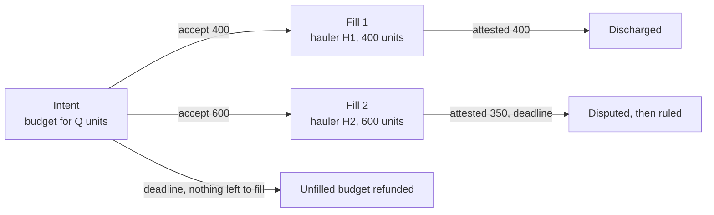

# ADR 0008: Distribution intents

- **Status:** Proposed
- **Recorded:** 2026-10-28
- **Builds on:** [ADR 0004](0004-transfer-settlement-and-proofs.md) (delivery
  obligations and proofs), [ADR 0005](0005-endpoint-only-transport.md) (the path
  is not enforced), [ADR 0006](0006-agreement-primitive.md) (agreements) and
  [ADR 0007](0007-network-authority.md) (networks)
- **Addresses:** ADR 0006 open question 5 (partial performance and more than two
  parties), and ADR 0006 phase 2's need for a second instance

## Context

### A Transfer prescribes the job

A Transfer says: take *this* stock, which I put in escrow, from source A to
destination B. The lister supplies the goods, picks both ends, and the manifest is
all-or-nothing. That is the right shape for moving your own stock. It cannot
express what a lister usually wants: "I need Q of K at depot A by T, and here is
the budget." Where the goods come from does not matter to that lister.

### The outcome is what matters

The [vision](../vision.md) positions haulers as solvers. The protocol fixes the end
state and the payment, and the hauler composes whatever movement, buying and
selling reaches it. ADR 0005 already stopped the protocol enforcing how goods
travel. This ADR stops it caring where the goods come from.

### What the chain can observe

- **A handoff.** The delivery adapter certifies, in one transaction, that goods
  moved into a depot (ADR 0004). This is attestable today for a Transfer manifest.
- **Ownership.** A handoff can be certified as moving goods from the hauler's
  holdings to the lister's.
- **A stock level.** An adapter can report how much of K a party holds at a depot
  at a moment. A level alone says nothing about who put the goods there or when.

## Decision

### 1. An intent is an agreement without the lister's goods

An **intent** is a new kind of haul agreement on the ADR 0006 model. It carries
consideration (the budget) and bonds, and **no custody**: the hauler supplies the
goods.

| | Transfer | Intent |
|---|---|---|
| Lister supplies | goods and reward | budget only |
| Terms | source, destination, manifest | target depots, item, quantity, deadline |
| Custody | the manifest | none |
| Performance | the whole manifest handed over at the destination | delivered quantity credited to the lister |
| Fills | one hauler, all or nothing | several haulers, partial |

```move
public struct IntentTerms has store {
    targets: vector<ID>,     // registered depots; a delivery to any of them counts
    collection_id: ID,       // the item, as a multicoin collection and asset
    asset_id: u64,
    quantity: u64,           // total wanted
    filled: u64,             // reserved by accepted fills
    delivered: u64,          // attested so far
    min_fill: u64,           // smallest quantity one hauler may take
    unit_budget: u64,        // consideration per unit, in the reward asset
    deliver_by_ms: u64,
}
```

### 2. Performance is attested deliveries, never stock levels

An intent pays for goods **delivered for it**: moved from the hauler's holdings to
the lister's at a target depot, certified by a registered adapter in the same
transaction, and bound to the intent and the fill. Goods already at the depot,
goods the lister moves themselves, and goods moved by someone else do not count.

This reuses the non-droppable obligation pattern of ADR 0004. The adapter's proof
names the quantity instead of a manifest:

```move
/// Minted by a registered adapter; consumed by the intent's attestor.
public struct VerifiedSupply {
    intent_id: ID,
    fill_id: ID,
    depot: ID,
    collection_id: ID,
    asset_id: u64,
    quantity: u64,
    from: address,   // the hauler
    to: address,     // the lister
}
```

### 3. Partial fills are separate two-party agreements

An intent is an **offer** that many haulers can take part of. Accepting it carves
out a **fill**: an ordinary two-party agreement (lister and one hauler) for a
quantity of at least `min_fill`, with consideration `quantity * unit_budget` moved
out of the intent's budget and a bond posted by the hauler at the network's
collateral ratio.



- **Each fill has the ADR 0006 lifecycle.** It is attested, challenged, discharged
  or ruled on its own. One hauler's breach does not touch another's fill.
- **The agreement core stays two-party.** Several haulers are several agreements
  carved from one offer, which answers ADR 0006 open question 5 without adding
  multi-party rulings.
- **A fill may deliver in several handoffs.** It discharges once the attested
  quantity reaches the fill's quantity; delivering less by the deadline is a
  `DeadlineMissed` dispute, and a ruling can pay for the part delivered.
- **The intent closes** when its deadline passes or every unit is delivered. Budget
  no fill reserved returns to the lister.

### 4. A set of depots means "any of them"

`targets` lists registered depots of the intent's network, and a delivery to any
of them counts. Statements that need proportions ("spread across these depots")
are several intents, one per depot.

### 5. Standing intents spawn intents when stock runs low

"Always keep at least Q of K at A" is not one agreement that completes once, and
checking the level at scheduled times can be gamed. It is a **standing intent**: a
funded policy that opens ordinary intents.

```move
public struct StandingIntent has key {
    id: UID,
    network_id: ID,
    lister: address,
    depot: ID,
    collection_id: ID,
    asset_id: u64,
    floor: u64,              // below this, a top-up may be opened
    target: u64,             // a top-up asks for target - current level
    unit_budget: u64,
    top_up_window_ms: u64,   // deliver_by for each spawned intent
    cooldown_ms: u64,        // minimum time between top-ups
    // plus the remaining budget as a holding
}
```

- **Anyone may trigger a top-up** by presenting an adapter-certified stock level
  below `floor`. The standing intent then opens an intent for `target - level`,
  funded from its budget.
- **Only one top-up is open at a time**, and `cooldown_ms` limits how often they
  open, so the budget cannot be drained faster than the lister chose.
- **The lister may lower its own stock** to trigger a top-up. That spends only the
  lister's budget, so it is not an attack.

A shortfall-triggered service agreement, where one hauler commits for a period and
a reported shortfall starts a response deadline, is the alternative. It is
deferred: standing intents need nothing new from the agreement core.

### 6. Prices stay off the protocol

The lister sets `unit_budget`. Whether it is enough is for haulers to judge. A
hauler may buy the goods on a market and deliver them in one programmable
transaction; the protocol sees only the attested supply.

### 7. Intents are ADR 0006's second instance

ADR 0006 phase 2 extracts the generic agreement package once a second instance is
scheduled. Intents are that instance: they share the lifecycle, holdings, rulings
and bindings with Transfer, and differ in terms, attestor and the absence of
custody. Intents are built after ADR 0006 phase 1 and ADR 0007, as part of phase 2.

## Consequences

**Positive**

- **Listers can ask for outcomes**, not just movements of their own stock.
- **Haulers compete as solvers**, using markets where useful.
- **The agreement core stays two-party**, with partial fills as separate
  agreements.
- **Standing statements are possible** without continuous on-chain monitoring.

**Negative**

- **Adapters need two new certifications**: quantity-level supply bound to an
  intent and a fill, and a stock-level report. Both are trusted the way delivery
  adapters are today.
- **More objects per intent.** Each fill is its own agreement object.
- **Small fills cost more to bond and dispute.** `min_fill` limits this, but the
  right value depends on the network.

**Neutral**

- **Transfer is unchanged.** It stays the job for moving the lister's own stock.

## Open questions

1. **Bond sizing.** Is the network's collateral ratio right for fills, where the
   hauler, not the lister, supplies the goods?
2. **Fill reservations.** How long may a fill hold quantity before it must deliver,
   so a hauler cannot reserve the whole intent and never deliver?
3. **Partial delivery rulings.** What should the default ruling be for a fill that
   delivered part of its quantity by the deadline?
4. **Baskets.** Should one intent ask for several items, or should a basket be
   several intents?
5. **Trigger incentives.** Should whoever triggers a top-up be paid from the
   standing budget, so someone has a reason to watch levels?
6. **Clear-out and ceilings.** "Get stock out of A" needs a destination or a sink.
   Is it a Transfer to any depot in a set, or a separate kind of intent?

## Verification (planned)

- **Supply proofs:** a `VerifiedSupply` for another intent, fill, item, depot or
  recipient is rejected; one minted by an unregistered adapter is rejected.
- **No double counting:** a fill's attested quantity never exceeds its quantity,
  and the intent's delivered total never exceeds its quantity.
- **Budget conservation:** fills reserve exactly `quantity * unit_budget`, and every
  unit of budget ends with a hauler, the treasury or the lister.
- **Standing intents:** a level at or above `floor` cannot trigger a top-up; a
  second top-up cannot open while one is open or during the cooldown.
- **Live scenarios:** two haulers fill one intent, one delivers in full and one
  partially; a standing intent tops up a depot after its level falls below the
  floor.
