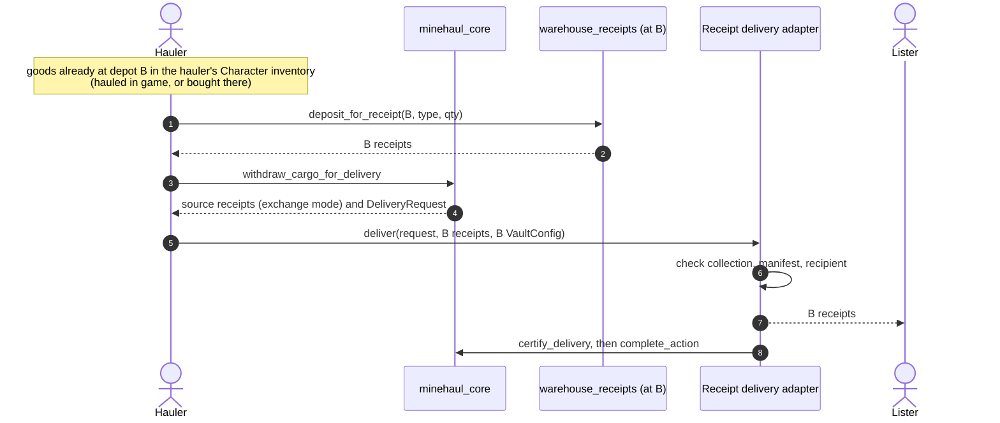

# ADR 0009: The delivery adapter contract

- **Status:** Proposed
- **Recorded:** 2026-10-28
- **Resolves:** ADR 0004's "remaining integration decision" (what a production
  adapter must verify before `certify_delivery`)
- **Builds on:** [ADR 0004](0004-transfer-settlement-and-proofs.md) (the
  non-droppable `DeliveryRequest`), [ADR 0005](0005-endpoint-only-transport.md)
  (endpoints only) and [ADR 0007](0007-network-authority.md) (registry checks in
  core)
- **Addresses:** TODO Layer 2; #22 (single extension slot) for delivery

## Context

### What core asks of an adapter today

`withdraw_cargo_for_delivery` releases the whole escrowed manifest to the hauler's
transaction, together with a `DeliveryRequest` that binds the job, network,
registry, destination, hauler and manifest hash. Only a registered adapter's
module can turn it into a `VerifiedDelivery`, which `complete_action` consumes.
`certify_delivery` documents the duty: verify the whole manifest was delivered.
An SSU check is not enough. No production adapter exists; the localnet scenario
simulates delivery by transferring the escrowed tokens to a fixed address.

### How goods exist on chain

At world-contracts `8eb197e` (tag `v0.0.18`):

- **Items enter the chain through the game server.**
  `game_item_to_chain_inventory` mints items into a Character's inventory at an SSU
  and must be sponsored by the server's admin ACL. `chain_item_to_game_inventory`
  burns them back with a server-signed location proof.
- **Items never move between SSUs on chain.** Every deposit asserts the item's
  parent is the receiving SSU. Moving goods from A to B happens in the game.
- **So an item in an on-chain inventory at B is server-backed evidence that the
  goods are at B.** The chain cannot say how they got there, which ADR 0005 does
  not ask it to.

### Warehouse receipts

`loash-industries/warehouse-receipts` is a storage unit extension:

- **One multicoin collection per SSU**, recorded in a shared `VaultConfig`
  (`storage_unit_id`, `collection_id`). A receipt's `asset_id` is the world item's
  `type_id`.
- **`deposit_for_receipt`** (public) moves items from the caller's Character
  inventory into the SSU's open inventory and mints receipts of equal quantity.
- **`redeem_receipt`** (public) burns receipts and moves the items into the
  redeemer's Character inventory, at that SSU only.
- **Receipts are bearer multicoin balances.** They can be transferred, split and
  traded; the package names Trinary Exchange multicoin pools as an intended use.

Because both functions are public, another package can compose with them. Minehaul
does not need to be the SSU's extension.

### Shared types

Warehouse receipts tracks multicoin `main` (`2772c26`, the revision Trinary
Exchange pins). Minehaul pins `c7a97f2`. A receipt can be escrowed in a
`HaulAction` only if both packages link the same published multicoin package.

## Decision

### 1. Cargo is receipts; delivery is receipts at the destination

On networks using this adapter, a Transfer's escrowed cargo is warehouse receipts
from the **source** depot's collection. Each manifest line names a receipt
collection, an `asset_id` (the item's `type_id`) and a quantity.

**Delivery is handing the lister receipts from the destination depot's collection
for the same `asset_id`s and quantities.** The adapter checks, in the delivery
transaction:

- **The collection is the destination's.** The presented `VaultConfig` has
  `storage_unit_id == request.destination`, and every delivered receipt's
  collection is that config's `collection_id`.
- **The manifest is matched exactly.** For every manifest line there is delivered
  value of the same `asset_id` equal to the line's quantity, and nothing else is
  delivered.
- **The recipient is fixed.** The receipts go to the lister named in the request,
  never to an address the transaction chooses.

Then it calls `certify_delivery`. Every check is on chain; the adapter holds no
keys and needs no operator.

### 2. Two custody modes, one delivery check

When the lister's source receipts leave escrow is a listing term:

| Mode | Source receipts go to the hauler | The lister's risk | Bond needed |
|---|---|---|---|
| **Exchange** | at delivery, in the same transaction | none: they swap atomically | covers delay only |
| **Courier** | at collection | the cargo, until delivery | covers the cargo's value (#21) |

- **Exchange is the default and ships first.** It is what core already does:
  `withdraw_cargo_for_delivery` hands the escrowed balances to the hauler's
  transaction. The hauler must hold equivalent goods at the destination first,
  either hauled there earlier or bought there.
- **Courier comes after #21.** `confirm_collection` would release the receipts so
  the hauler can redeem them at the source and carry the goods. Until collateral can
  cover the cargo's value, releasing custody early is unsafe.

The delivery check is identical in both modes.

### 3. Core changes

- **`DeliveryRequest` gains `lister: address`**, so the adapter can send receipts to
  the fixed recipient.
- **`DeliveryRequest` exposes its manifest lines** (`delivery_manifest`), so the
  adapter checks lines directly instead of recomputing a hash in another package.
  The hash stays for `complete_action`'s check.
- **The listing terms gain the custody mode.** Only `Exchange` is accepted until
  courier mode is enabled.
- **Nothing in core learns about warehouse receipts or world-contracts.** Core stays
  world-agnostic (ADR 0001); all receipt knowledge lives in the adapter.

### 4. Replay, uniqueness, freshness and retries

- **Replay and uniqueness:** the `DeliveryRequest` is a single-use obligation, and the
  delivered receipts are objects transferred to the lister. Neither can be used
  twice.
- **Freshness:** not required. Receipts minted earlier, or bought on a market, are
  valid: the lister wanted goods at the destination, and receipts prove they are
  there. ADR 0005 already declines to prove how goods travelled.
- **Retries:** delivery is one atomic transaction. A failure leaves the job in
  `Collected` with escrow untouched, and the hauler resubmits.
- **No external reference.** The on-chain receipts and events are the evidence. The
  adapter emits `ReceiptDelivery { action_id, collection_id, lines }` for indexers
  and disputes.

### 5. The depot's extension must stay warehouse receipts

Receipts are claims on items in a depot's open inventory. If a depot's owner swaps
the extension, the new extension can withdraw those items and leave the receipts
unbacked. Both depots of a job must therefore keep warehouse receipts as their
extension, with the configuration frozen:

- **The adapter checks `is_extension_frozen`** for the destination at delivery.
- **Registration should prove** the extension is warehouse receipts. world-contracts
  has no public getter for the current extension (#22), so this is an open question.
- **Losing the extension or the SSU going offline** during a job ends it as void,
  not as the hauler's breach, once ADR 0006 rulings exist.

### 6. Adapter identity, versions and revocation

- **One adapter package per world-contracts version.** `minehaul_world_v0` targets
  `8eb197e`; a breaking world upgrade gets `minehaul_world_v1`, with its own
  `AdapterAuth` whose `world_version` records it.
- **Moving to a new version:** each network registers the new auth and revokes the
  old one. Open jobs certify through whichever adapters the network trusts at
  delivery time (ADR 0007 decision 6).
- **Per-network revocation** stays with the network's admin role.
- **Global retirement:** every adapter package exposes `retire_auth`, gated by its
  publisher's governance. `minehaul_world_v0` currently has none; adding one is
  part of this work.
- **Upgrades** of an adapter package follow ADR 0007 decision 10: the `UpgradeCap`
  is under governance with a timelock, or the package is immutable.

### 7. What governance sees in a dispute

Exchange-mode delivery leaves little to dispute: the lister holds the destination
receipts and the hauler the source receipts. Disputes reduce to:

- **A missed deadline:** the job has no `ActionDelivered` event in time.
- **Unbacked receipts:** redeeming the delivered receipts at the destination fails.
  That failed redemption, together with the `ReceiptDelivery` event, is the
  evidence.

Networks using this adapter may set a short challenge window (zero is already
allowed).

### 8. Conformance

A delivery adapter conforms if, on the localnet harness, it:

- **certifies** a multi-line manifest delivered with exact receipts at the
  destination;
- **rejects** receipts from another depot's collection, a wrong `asset_id`, short
  or excess quantities, a `VaultConfig` for another SSU, and a request for another
  network or registry;
- **sends** delivered receipts only to the request's lister;
- **leaves escrow untouched** when certification aborts.

The localnet `LocalDelivery` is replaced by a localnet build of this adapter
against world-contracts and warehouse receipts, so the acceptance matrix exercises
the production contract.

## Prerequisites

1. **Align multicoin** with warehouse receipts and Trinary Exchange (`2772c26` today),
   and confirm all three link the same published package on each target network.
2. **Depend on warehouse receipts** from `minehaul_world_v0`, which deliberately does
   not yet.
3. **Run warehouse receipts in the localnet harness**, with real SSUs and the
   server-sponsored bridge simulated.

## Consequences

**Positive**

- **No oracle and no operator.** Delivery is checked entirely on chain against
  server-backed inventory, so TODO's open questions about who runs the adapter and
  whether an off-chain receipt is needed are answered: nobody, and no.
- **No extension slot conflict with receipts.** Minehaul composes with warehouse
  receipts instead of claiming the slot, so a depot's receipts can serve Minehaul
  and any market that trades them.
- **Exchange mode needs no cargo valuation.** The lister never gives up custody
  without receiving the destination goods.
- **Haulers can source goods anywhere**, including buying destination receipts from
  another holder, which matches the solver model in the [vision](../vision.md).

**Negative**

- **Exchange mode needs hauler capital.** A hauler must hold goods at the
  destination before being paid in source goods. Haulers without stock wait for
  courier mode.
- **Depots must run warehouse receipts, frozen.** Networks cannot use depots with
  other extensions.
- **Fungible delivery.** The lister receives goods of the same type and quantity,
  not the same units. Items with per-unit identity cannot use this adapter.
- **Trust moves to warehouse receipts.** A bug there can make receipts unbacked.

## Open questions

1. **Proving the extension at registration.** Without a public getter, how does
   registration confirm a depot runs warehouse receipts? Options: an upstream
   getter, or a registration step that mints and burns a receipt.
2. **Tenants.** Items and SSUs carry a tenant. Must a job's two depots share one?
3. **Capacity.** A destination's open inventory can be full. Does that void the job
   or count against the hauler?
4. **Courier mode's collection step.** Should the receipts be released freely, or
   only through an adapter call that redeems them at the source in the same
   transaction?
5. **ADR 0008 intents.** A fill would deliver destination receipts the same way, with
   no source receipts. Does this settle ADR 0008's supply certification?

## Verification (planned)

- **Unit tests** in the adapter package for every rejection in decision 8.
- **Compile probes:** a module outside the adapter cannot certify a receipt delivery.
- **Live scenarios:** exchange-mode Transfer with two item types; delivery with
  receipts bought from a third party; a rejected delivery with another depot's
  receipts; an unfrozen destination rejected.
