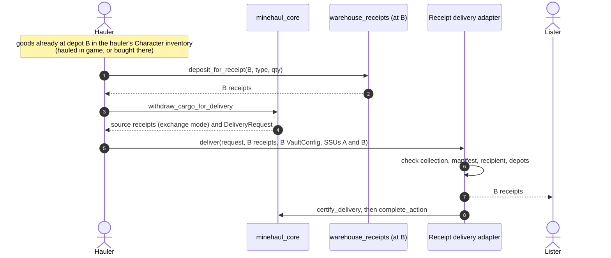

# ADR 0009: The delivery adapter contract

- **Status:** Proposed
- **Recorded:** 2026-10-28
- **Revised:** 2026-10-28 (dedicated depots, markets as endpoints, depot loss)
- **Resolves:** ADR 0004's "remaining integration decision" (what a production
  adapter must verify before `certify_delivery`)
- **Builds on:** [ADR 0004](0004-transfer-settlement-and-proofs.md) (the
  non-droppable `DeliveryRequest`), [ADR 0005](0005-endpoint-only-transport.md)
  (endpoints only) and [ADR 0007](0007-network-authority.md) (registry checks in
  core)
- **Addresses:** TODO Layer 2; #22 (single extension slot) for delivery

## Context

### What core asks of an adapter today

`withdraw_cargo_for_delivery` releases the whole escrowed manifest to the hauler's
transaction, together with a `DeliveryRequest` that binds the job, network,
registry, destination, hauler and manifest hash. Only a registered adapter's
module can turn it into a `VerifiedDelivery`, which `complete_action` consumes.
`certify_delivery` documents the duty: verify the whole manifest was delivered.
An SSU check is not enough. No production adapter exists; the localnet scenario
simulates delivery by transferring the escrowed tokens to a fixed address.

### How goods exist on chain

At world-contracts `8eb197e` (tag `v0.0.18`):

- **Items enter the chain through the game server.**
  `game_item_to_chain_inventory` mints items into a Character's inventory at an SSU
  and must be sponsored by the server's admin ACL. `chain_item_to_game_inventory`
  burns them back with a server-signed location proof.
- **Items never move between SSUs on chain.** Every deposit asserts the item's
  parent is the receiving SSU. Moving goods from A to B happens in the game.
- **So an item in an on-chain inventory at B is server-backed evidence that the
  goods are at B.** The chain cannot say how they got there, which ADR 0005 does
  not ask it to.

### Warehouse receipts

`loash-industries/warehouse-receipts` is a storage unit extension:

- **One multicoin collection per SSU**, recorded in a shared `VaultConfig`
  (`storage_unit_id`, `collection_id`). A receipt's `asset_id` is the world item's
  `type_id`.
- **`deposit_for_receipt`** (public) moves items from the caller's Character
  inventory into the SSU's open inventory and mints receipts of equal quantity.
- **`redeem_receipt`** (public) burns receipts and moves the items into the
  redeemer's Character inventory, at that SSU only.
- **Receipts are bearer multicoin balances.** They can be transferred, split and
  traded; the package names Trinary Exchange multicoin pools as an intended use.

Because both functions are public, another package can compose with them. Minehaul
does not need to be the SSU's extension.

### The extension slot

An SSU has one extension slot. Only the extension it names can move items into or
out of the SSU's open inventory, which is where receipt-backed items sit. The
SSU's owner can swap the extension at any time (`authorize_extension`), and a new
extension could withdraw those items and leave the receipts unbacked.
`freeze_extension_config` locks the slot permanently. `is_extension_frozen` is
public, but storage units, unlike gates and turrets, have no public getter for
*which* extension is installed.

### Depots can be destroyed

`storage_unit::unanchor` and `unanchor_orphan`, sponsored by the game server,
delete the SSU object and every inventory in it, frozen or not. They emit
`StatusChangedEvent` (`UNANCHORED`) and an `ItemDestroyedEvent` per item. A
Move transaction cannot prove this happened:

- **A deleted object cannot be an input**, so nothing can present the lost SSU.
- **The object registry does not forget.** `object_registry::object_exists` stays
  true after deletion; the registry's reclaim path is commented out.
- **Killmails do not name the structure.** A `Killmail` records the victim
  Character, not the SSU, and has no public getters.

A transaction can only prove the opposite: an SSU it presents still exists.

### Shared types

Warehouse receipts tracks multicoin `main` (`2772c26`, the revision Trinary
Exchange pins). Minehaul pins `c7a97f2`. A receipt can be escrowed in a
`HaulAction` only if both packages link the same published multicoin package.

## Decision

### 1. Cargo is receipts; delivery is receipts at the destination

On networks using this adapter, a Transfer's escrowed cargo is warehouse receipts
from the **source** depot's collection. Each manifest line names a receipt
collection, an `asset_id` (the item's `type_id`) and a quantity.

**Delivery is handing the lister receipts from the destination depot's collection
for the same `asset_id`s and quantities.** The adapter checks, in the delivery
transaction:

- **The collection is the destination's.** The presented `VaultConfig` has
  `storage_unit_id == request.destination`, and every delivered receipt's
  collection is that config's `collection_id`.
- **The manifest is matched exactly.** For every manifest line there is delivered
  value of the same `asset_id` equal to the line's quantity, and nothing else is
  delivered.
- **The recipient is fixed.** The receipts go to the recipient named in the
  request, never to an address the transaction chooses.
- **Both depots still exist.** The destination SSU is presented. In exchange mode
  the source SSU is presented too, so the hauler is never paid in receipts of a
  depot that is gone (decision 7).

Then it calls `certify_delivery`. Every check is on chain; the adapter holds no
keys and needs no operator.

### 2. Two custody modes, one delivery check

When the lister's source receipts leave escrow is a listing term:

| Mode | Source receipts go to the hauler | The lister's risk | Bond needed |
|---|---|---|---|
| **Exchange** | at delivery, in the same transaction | none: they swap atomically | covers delay only |
| **Courier** | at collection | the cargo, until delivery | covers the cargo's value (#21) |

- **Exchange is the default and ships first.** It is what core already does:
  `withdraw_cargo_for_delivery` hands the escrowed balances to the hauler's
  transaction. The hauler must hold equivalent goods at the destination first,
  either hauled there earlier or bought there.
- **Courier comes after #21.** `confirm_collection` would release the receipts so
  the hauler can redeem them at the source and carry the goods. Until collateral can
  cover the cargo's value, releasing custody early is unsafe.

The delivery check is identical in both modes.

### 3. Core changes

- **`DeliveryRequest` gains `source: ID` and `recipient: address`**, so the adapter
  can require the source depot and send receipts to the fixed recipient. Until
  decision 6 is designed, the recipient is the lister.
- **`DeliveryRequest` exposes its manifest lines** (`delivery_manifest`), so the
  adapter checks lines directly instead of recomputing a hash in another package.
  The hash stays for `complete_action`'s check.
- **The listing terms gain the custody mode.** Only `Exchange` is accepted until
  courier mode is enabled.
- **Registered depots gain a lost state**, and jobs gain a void transition
  (decision 7).
- **Nothing in core learns about warehouse receipts or world-contracts.** Core stays
  world-agnostic (ADR 0001); all receipt knowledge lives in the adapter.

### 4. Replay, uniqueness, freshness and retries

- **Replay and uniqueness:** the `DeliveryRequest` is a single-use obligation, and the
  delivered receipts are objects transferred to the recipient. Neither can be used
  twice.
- **Freshness:** not required. Receipts minted earlier, or bought on a market, are
  valid: the lister wanted goods at the destination, and receipts prove they are
  there. ADR 0005 already declines to prove how goods travelled.
- **Retries:** delivery is one atomic transaction. A failure leaves the job in
  `Collected` with escrow untouched, and the hauler resubmits.
- **No external reference.** The on-chain receipts and events are the evidence. The
  adapter emits `ReceiptDelivery { action_id, collection_id, lines }` for indexers
  and disputes.

### 5. Depots are dedicated to logistics

A depot is a storage unit given to the logistics network. It does not double as a
market, a vending machine or anything else: its extension is warehouse receipts,
frozen.

- **Why frozen:** receipts are claims on the depot's open inventory. Only a frozen
  slot guarantees no other extension can ever drain it.
- **Registration proves it once.** The world adapter's registration step, in one
  transaction:
  1. checks `is_extension_frozen`;
  2. calls `deposit_for_receipt` for one unit, then `redeem_receipt` for it.

  The deposit succeeds only if warehouse receipts is the installed extension, and
  the frozen slot keeps it installed for the SSU's lifetime. The registrant needs
  one item in their Character inventory at the depot.
- **No per-delivery extension check.** After registration, presenting the SSU
  (decision 1) is enough: a frozen slot cannot change, and an SSU that still exists
  has not been unanchored.
- **Markets use the depot's receipts, not the depot.** Receipts are bearer
  balances, so a market can trade them without any access to the SSU.

Whether one SSU may serve several networks remains ADR 0007 open question 2.

### 6. Markets reach Minehaul as delivery endpoints

A market that needs goods moved does not install itself on a depot. It uses
Minehaul's delivery system, and from the job's point of view it is an
**endpoint**: a destination depot plus a recipient that is not the lister's own
address, such as the lister's account on the market. The goods physically sit in
the depot; the market receives the claim on them.

This is a direction, not yet a design. What holds now:

- **An endpoint is (depot, recipient).** The depot is always a registered,
  dedicated depot; there is no separate "market depot".
- **The recipient is fixed at listing** and carried in the `DeliveryRequest`, so
  decision 1's fixed-recipient rule still holds.
- **Depositing into a market account** needs a per-market adapter or call, designed
  when a market such as Trinary Exchange offers one.

### 7. Depot loss voids the jobs that depend on it

A destroyed depot takes its goods with it. Minehaul does not insure against that.
It makes sure the network stays consistent and nobody is punished for the loss.

- **The network attests the loss.** Since destruction cannot be proven on chain,
  the network's admin role (ADR 0007) calls `mark_depot_lost`, citing the
  `UNANCHORED` event. The registry keeps the entry as `Lost { at_ms }` instead of
  deleting it, so jobs and indexers can still resolve it.
- **No new work touches a lost depot.** Listings and claims naming it abort.
- **Jobs that depend on it become voidable.** Anyone may void a listed, claimed or
  collected job whose source or destination is lost: escrow returns to the lister,
  collateral to the hauler, nothing is slashed, nothing goes to the treasury. This
  is ADR 0006's `Void` outcome.
- **Losses stay where the world put them.** Escrowed receipts of a lost source
  depot return to the lister unbacked; delivered receipts of a lost destination are
  the recipient's. Minehaul does not shift a loss to another party.
- **If the admin does not attest,** the hauler disputes the expired job and argues
  the loss there, and the resolver can rule `Void`.
- **Why an attestation is acceptable here:** `Void` returns every stake to its
  owner, so a false mark gains nobody value; at worst it lets a hauler escape a
  slash, and the admin who could do that already judges disputes.
- **Rebuilding is registering afresh.** A rebuilt structure is a new object with a
  new ID and goes through decision 5 again.
- **Intents** (ADR 0008) drop a lost depot from their targets, and are void if none
  remain.

Offline is not lost. An SSU without fuel keeps its items but blocks deposits and
redemptions, so delivery to it fails until it is back online while the job's
deadline keeps running (open question 3).

### 8. Adapter identity, versions and revocation

- **One adapter package per world-contracts version.** `minehaul_world_v0` targets
  `8eb197e`; a breaking world upgrade gets `minehaul_world_v1`, with its own
  `AdapterAuth` whose `world_version` records it.
- **Moving to a new version:** each network registers the new auth and revokes the
  old one. Open jobs certify through whichever adapters the network trusts at
  delivery time (ADR 0007 decision 6).
- **Per-network revocation** stays with the network's admin role.
- **Global retirement:** every adapter package exposes `retire_auth`, gated by its
  publisher's governance. `minehaul_world_v0` currently has none; adding one is
  part of this work.
- **Upgrades** of an adapter package follow ADR 0007 decision 10: the `UpgradeCap`
  is under governance with a timelock, or the package is immutable.

### 9. What governance sees in a dispute

Exchange-mode delivery leaves little to dispute: the recipient holds the
destination receipts and the hauler the source receipts. Disputes reduce to:

- **A missed deadline:** the job has no `ActionDelivered` event in time.
- **A lost or offline depot:** the `UNANCHORED` or status events, judged under
  decision 7.

Unbacked receipts at a registered depot should be impossible under decision 5. If
redeeming delivered receipts fails anyway, that failure and the `ReceiptDelivery`
event are evidence of a bug in warehouse receipts or this adapter, not a hauler
breach.

Networks using this adapter may set a short challenge window (zero is already
allowed).

### 10. Conformance

A delivery adapter conforms if, on the localnet harness, it:

- **certifies** a multi-line manifest delivered with exact receipts at the
  destination;
- **rejects** receipts from another depot's collection, a wrong `asset_id`, short
  or excess quantities, a `VaultConfig` for another SSU, a missing or mismatched
  source or destination SSU, and a request for another network or registry;
- **sends** delivered receipts only to the request's recipient;
- **leaves escrow untouched** when certification aborts.

Its registration step conforms if it rejects an SSU whose slot is not frozen, and
one frozen on another extension.

The localnet `LocalDelivery` is replaced by a localnet build of this adapter
against world-contracts and warehouse receipts, so the acceptance matrix exercises
the production contract.

## Prerequisites

1. **Align multicoin** with warehouse receipts and Trinary Exchange (`2772c26` today),
   and confirm all three link the same published package on each target network.
2. **Depend on warehouse receipts** from `minehaul_world_v0`, which deliberately does
   not yet.
3. **Run warehouse receipts in the localnet harness**, with real SSUs, the
   server-sponsored bridge simulated, and `unanchor` available to scenarios.

## Consequences

**Positive**

- **No oracle and no operator.** Delivery is checked entirely on chain against
  server-backed inventory, so TODO's open questions about who runs the adapter and
  whether an off-chain receipt is needed are answered: nobody, and no.
- **No extension slot conflict.** Depots run warehouse receipts and nothing else;
  Minehaul and markets both work through receipts.
- **Exchange mode needs no cargo valuation.** The lister never gives up custody
  without receiving the destination goods.
- **Haulers can source goods anywhere**, including buying destination receipts from
  another holder, which matches the solver model in the [vision](../vision.md).
- **Depot loss has a defined outcome.** The network stays consistent and nobody is
  slashed for a destroyed structure.

**Negative**

- **Exchange mode needs hauler capital.** A hauler must hold goods at the
  destination before being paid in source goods. Haulers without stock wait for
  courier mode.
- **Depots are single-purpose and frozen for life.** An owner who registers a depot
  gives up its extension slot permanently.
- **Depot owners are still trusted not to tear depots down.** Freezing does not stop
  `unanchor`. A network chooses which depots to register, and that is the trust
  boundary.
- **Depot loss is attested, not proven.** It rests on the network's admin role.
- **Fungible delivery.** The recipient receives goods of the same type and quantity,
  not the same units. Items with per-unit identity cannot use this adapter.
- **Trust moves to warehouse receipts.** A bug there can make receipts unbacked.

## Open questions

1. **Tenants.** Items and SSUs carry a tenant. Must a job's two depots share one?
2. **Capacity.** A destination's open inventory can be full. Does that void the job
   or count against the hauler?
3. **Offline depots.** Should time a depot spends offline extend the deadlines of
   jobs that need it, and can the adapter observe it (a public status getter)?
4. **Courier mode and depot loss.** After collection the hauler holds the lister's
   goods. If the destination is then lost, voiding cannot take them back. Should
   the lister re-route to another depot, or the cargo bond pay out? This must be
   settled before courier mode ships.
5. **Courier mode's collection step.** Should the receipts be released freely, or
   only through an adapter call that redeems them at the source in the same
   transaction?
6. **Market endpoints.** Which recipients may a listing name, and who supplies the
   call that deposits into a market account (decision 6)?
7. **ADR 0008 intents.** A fill would deliver destination receipts the same way, with
   no source receipts. Does this settle ADR 0008's supply certification, and retire
   its requirement that the adapter be the depot's extension?

## Verification (planned)

- **Unit tests** in the adapter package for every rejection in decision 10.
- **Compile probes:** a module outside the adapter cannot certify a receipt delivery.
- **Core tests:** listings and claims naming a lost depot abort; voiding a job with a
  lost depot returns escrow and collateral in full; voiding a job whose depots are
  all live aborts.
- **Live scenarios:** exchange-mode Transfer with two item types; delivery with
  receipts bought from a third party; a rejected delivery with another depot's
  receipts; registration of an unfrozen SSU rejected; a destination unanchored
  mid-job, marked lost, and the job voided without a slash.
